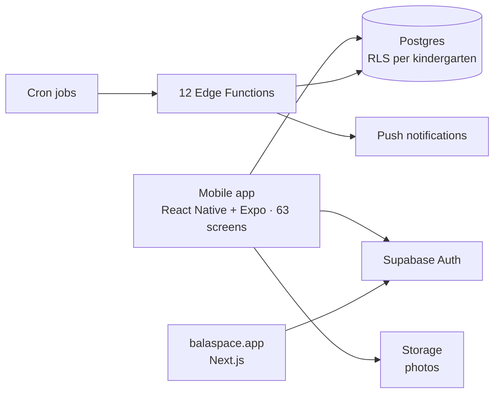

# BalaSpace — platform for private kindergartens

[balaspace.app](https://balaspace.app) · iOS and Android, in TestFlight since September 2026 · solo, built with Claude Code and Codex · 751 commits since March 2026

One app for three roles — director, teacher and parent: attendance with photos, announcements, daily reports, chat, push notifications, polls and analytics.

## Architecture

## How it's built

- **Backend:** 75 SQL migrations, row-level security that isolates each kindergarten's data, and 12 Edge Functions, several of them on cron.
- **Two-agent loop:** Claude Code writes the code and Codex reviews it in read-only mode. Fixes go back into the same review thread with their commit hashes until Codex has nothing left to flag.
- **Tests:** 208 Jest test files; CI runs type-checking and the test suite on every push; Maestro end-to-end flows run on a physical Android device (28 of 28 passing).

## Bugs worth telling

- **Cyrillic and `\b`.** In JavaScript, `\b` only understands ASCII letters, so seven Russian patterns in the chat filter silently matched nothing. They were rewritten with Unicode-aware boundaries: `(?<![\p{L}])…(?![\p{L}])` with the `u` flag.
- **An empty widget on Android.** Announcements on the parent's home screen were consistently empty on a real device, while a standalone script replaying the same `Promise.all` against the same database passed 10 times out of 10. The cause was concurrent fetches inside React Native, not the query; the announcements request now runs as its own `await`.
- **Silent reminders.** While triaging the first TestFlight build, I found that automatic payment reminders never went out: the cron function had been deployed with JWT verification switched on.

## Stack

React Native · Expo · TypeScript · Supabase (Postgres, RLS, Auth, Storage, Edge Functions) · Next.js · Jest · Maestro · GitHub Actions
