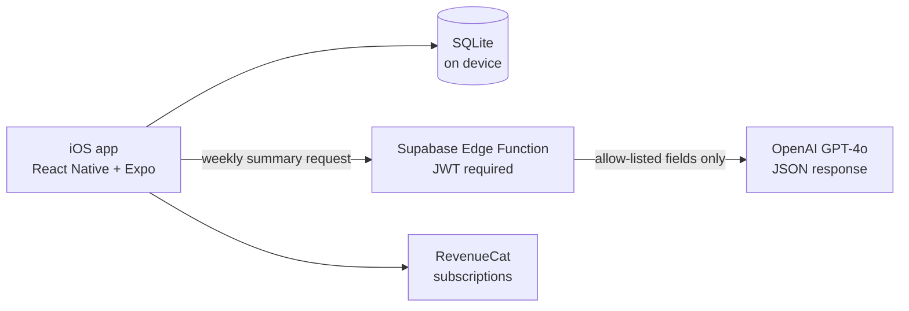

# Dosefy — GLP-1 therapy tracker for iOS

[App Store](https://apps.apple.com/app/id6760745705) · released March 2026, v1.1.0 in May · solo, built with Cursor, then Claude Code

An offline-first tracker for people on GLP-1 medications: injection log, reminders, PDF reports and a weekly AI summary. 141 users in the first 10 weeks (RevenueCat, May 2026).

## Architecture

The data lives on the device and the app has no user accounts; Supabase is used only to run the Edge Function that calls the model.

## A hardened LLM call

- **Prompt injection:** the function builds the prompt only from an allow-list of fields, so user-controlled text can't smuggle instructions in.
- **Payload limits:** the request size and shape are validated before anything reaches the model.
- **Authentication:** JWT verification is enforced for every Edge Function.

## An audit turned into a release

Four specialised AI audit agents reviewed the shipped app and produced 150 findings. In two days, 17–18 May, I closed the 52 that mattered, starting with 8 App Review blockers, and shipped version 1.1.0 on 25 May. 52 Jest tests and CI (type-check, lint, tests) guard the fixes.

## Stack

React Native · Expo · expo-sqlite · Supabase Edge Functions · OpenAI GPT-4o · RevenueCat · Jest · GitHub Actions
