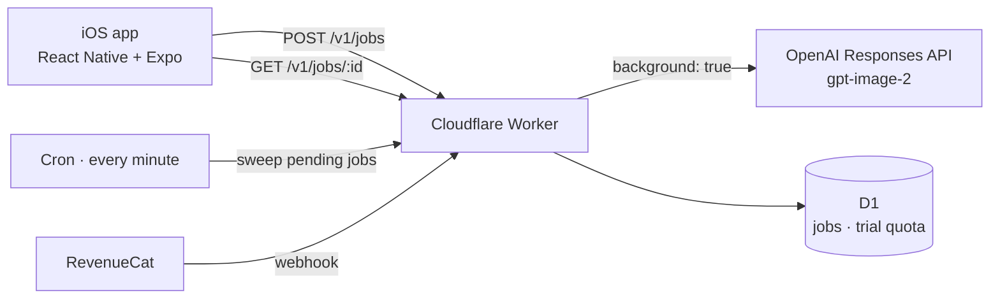

# STDIO — AI photo studio for iOS

[App Store](https://apps.apple.com/app/id6771886622) · [stdio.wtf](https://stdio.wtf) · May 2026 · solo, built with Claude Code

A selfie becomes an editorial portrait in one of a curated set of styles. From the first commit to the App Store release took 9 days: 19 → 27 May 2026, 167 commits.

## Architecture

## Key decisions

- **Generation runs outside the request.** A gpt-image-2 render takes 1–5 minutes, longer than a Worker can hold a request, and background tasks were cut off mid-generation. The fix: OpenAI's Responses API in background mode. The Worker submits a job and gets an id in under a second; a cron trigger sweeps pending jobs every minute; the app polls the job status.
- **One model, chosen on purpose.** An architecture decision record compares the options: gpt-image-1-mini was 3.2× cheaper ($0.052 vs $0.165 per high-quality portrait) but could not hold the premium look; gpt-image-1.5 cost more with no advantage. Decision: gpt-image-2 only.
- **No accounts.** An anonymous RevenueCat user id, a trial quota enforced on the server in D1, and subscriptions confirmed through a RevenueCat webhook.

## Getting through App Review

- **Build 8 was rejected on 6 points:** a missing terms link on the paywall, generic camera and photo permission texts, the paywall layout on iPad, questions about face data, disclosure and consent for a third-party AI provider, and a price mentioned in a screenshot. Build 9 fixed all six.
- **Build 15 was rejected for a crash on launch,** while Sentry showed 14 clean sessions for the same builds. The mismatch meant the crash happened before the SDK initialised. Native initialisation was wrapped in `try/catch` with Sentry breadcrumbs, and version 1.1.0 went live on 28 May.

## Stack

React Native · Expo · TypeScript · Cloudflare Workers (D1, KV, cron) · OpenAI API · RevenueCat · PostHog · Sentry
