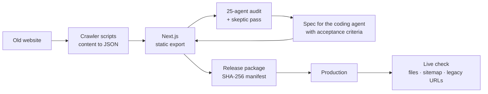

# vg.kz — corporate website of Volkovgeology JSC

[www.vg.kz](https://www.vg.kz) · live since September 2026 · 127 commits in 10 weeks · built with Claude Code and Codex

A full redesign of the website of a Kazatomprom group company: a static Next.js site in Russian, Kazakh and English — 328 pages — with the old site's content migrated by a crawler.

## Pipeline

## Highlights

- **Audit with a skeptic.** 25 AI agents covered 12 areas; every finding had to survive an independent agent whose job was to refute it. Result: 118 confirmed, 11 rejected as false. The confirmed ones became a spec for a coding agent, with acceptance criteria for each task.
- **Agent output reviewed by hand.** In one round of Codex changes I kept the improvements and fixed 5 regressions it had introduced.
- **Release automation.** Each release is a package with a SHA-256 manifest. After upload, a live check downloads every new or changed file from the site and compares its hash with the local build, verifies the sitemap and the redirects for legacy URLs. Link check: 0 broken links out of 10,307.

## Stack

Next.js · React · TypeScript · Tailwind CSS · Python (release scripts) · Node.js (crawler) · GitHub Actions
